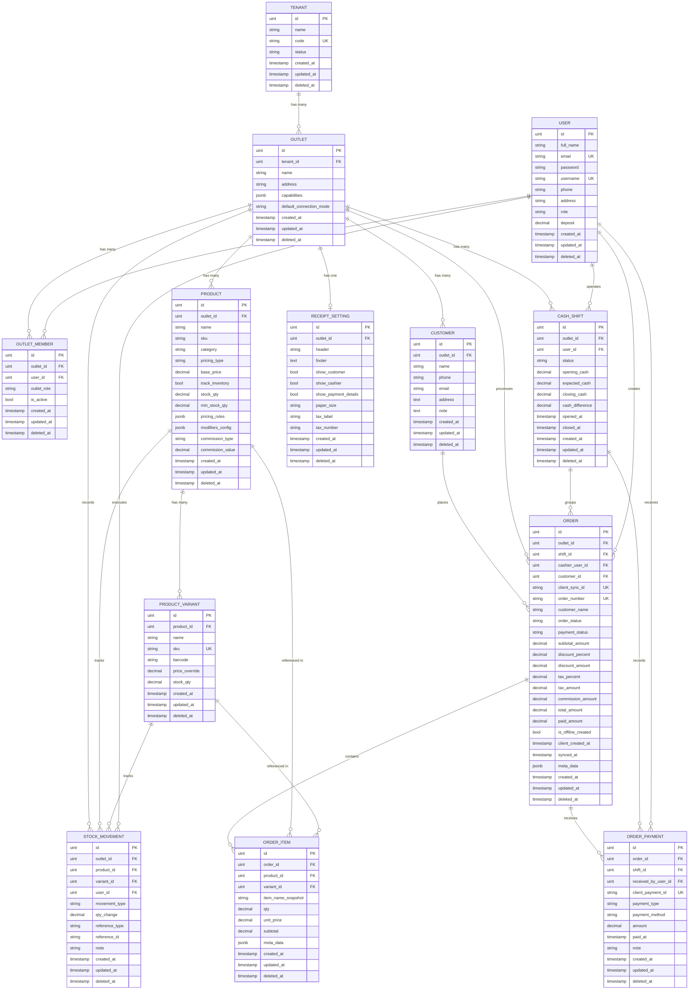

# ERD: Universal Multi-Capability POS Template

> Berdasarkan: PRD Universal Multi-Capability POS Template
> 
> 

ERD ini disusun untuk mendefinisikan model data inti POS berbasis *capability* pada **Go 1.25 + GORM + PostgreSQL**, mengikuti konvensi `PrimaryKey` (`uint` auto-increment) dan `BaseModelTimeAt` (`created_at`, `updated_at`, `deleted_at` soft delete), serta terhubung dengan entitas `USER` yang sudah ada.

---

## Diagram

---

## Deskripsi Entitas & Traceability ke PRD

### 1. USER (Sudah Ada)

Entitas pengguna sistem yang sudah tersedia sebagai referensi autentikasi dan relasi operasional.

| Field | Type | Constraint | Keterangan |
| --- | --- | --- | --- |
| `id` | `uint` | PK, auto-inc | Primary key

 |
| `full_name` | `varchar(100)` | NOT NULL | Nama lengkap

 |
| `email` | `varchar(100)` | NOT NULL, UNIQUE | Email login

 |
| `password` | `varchar(100)` | NOT NULL | Hashed password

 |
| `username` | `varchar(50)` | NOT NULL, UNIQUE | Username unik

 |
| `phone` | `varchar(15)` | NOT NULL | Nomor telepon

 |
| `address` | `text` | NOT NULL | Alamat lengkap

 |
| `role` | `varchar(20)` | DEFAULT 'customer' | Role sistem dasar

 |
| `deposit` | `decimal(15,2)` | DEFAULT 0 | Saldo deposit

 |
| `created_at` | `timestamp` | auto | Waktu dibuat

 |
| `updated_at` | `timestamp` | auto | Waktu diupdate

 |
| `deleted_at` | `timestamp` | nullable, index | Soft delete

 |

---

### 2. TENANT

*Traceability PRD:* Manajemen Multi-Tenant & Multi-Outlet.

| Field | Type | Constraint | Keterangan |
| --- | --- | --- | --- |
| `id` | `uint` | PK, auto-inc | Primary key

 |
| `name` | `varchar(150)` | NOT NULL | Nama usaha / organisasi |
| `code` | `varchar(50)` | NOT NULL, UNIQUE | Kode unik tenant |
| `status` | `varchar(20)` | NOT NULL, DEFAULT `'active'` | Status tenant (`active`, `inactive`) |
| `created_at` | `timestamp` | auto | Waktu dibuat

 |
| `updated_at` | `timestamp` | auto | Waktu diupdate

 |
| `deleted_at` | `timestamp` | nullable, index | Soft delete

 |

---

### 3. OUTLET

*Traceability PRD:* Manajemen Multi-Outlet, Sistem Capability Flag yang Dapat Diperluas, dan Mode Online-Default & Switch Offline.

| Field | Type | Constraint | Keterangan |
| --- | --- | --- | --- |
| `id` | `uint` | PK, auto-inc | Primary key

 |
| `tenant_id` | `uint` | FK (`tenants.id`), NOT NULL, index | Induk tenant |
| `name` | `varchar(150)` | NOT NULL | Nama cabang / outlet |
| `address` | `text` | NOT NULL | Alamat outlet |
| `capabilities` | `jsonb` | NOT NULL, DEFAULT `'{}'` | Flag kemampuan aktif (`enable_variants`, `enable_modifiers`, `enable_dimension_pricing`, `enable_tiered_pricing`, `enable_order_workflow`, `enable_partial_payment`, `enable_staff_commission`). Metadata registry tersedia via `GET /api/capabilities` (`apps/api/model/capability.go`). |
| `default_connection_mode` | `varchar(10)` | NOT NULL, DEFAULT `'online'` | Mode bawaan outlet (`online` atau `offline`) |
| `created_at` | `timestamp` | auto | Waktu dibuat

 |
| `updated_at` | `timestamp` | auto | Waktu diupdate

 |
| `deleted_at` | `timestamp` | nullable, index | Soft delete

 |

---

### 4. OUTLET_MEMBER

*Traceability PRD:* Manajemen Multi-Outlet dan Hak Akses Pengguna Dasar (Role-Based Access).

| Field | Type | Constraint | Keterangan |
| --- | --- | --- | --- |
| `id` | `uint` | PK, auto-inc | Primary key

 |
| `outlet_id` | `uint` | FK (`outlets.id`), NOT NULL, index | Outlet terkait |
| `user_id` | `uint` | FK (`users.id`), NOT NULL, index | Pengguna yang ditugaskan |
| `outlet_role` | `varchar(30)` | NOT NULL | Peran di outlet (`owner`, `manager`, `cashier`, `operator`) |
| `is_active` | `bool` | NOT NULL, DEFAULT `true` | Status keaktifan akses |
| `created_at` | `timestamp` | auto | Waktu dibuat

 |
| `updated_at` | `timestamp` | auto | Waktu diupdate

 |
| `deleted_at` | `timestamp` | nullable, index | Soft delete

 |

---

### 5. PRODUCT

*Traceability PRD:* Kasir & Keranjang Transaksi Inti, Kalkulasi Harga Fleksibel, Modifier/Tambahan, dan Manajemen Stok Dasar.

| Field | Type | Constraint | Keterangan |
| --- | --- | --- | --- |
| `id` | `uint` | PK, auto-inc | Primary key

 |
| `outlet_id` | `uint` | FK (`outlets.id`), NOT NULL, index | Pemilik katalog |
| `name` | `varchar(200)` | NOT NULL | Nama produk / layanan |
| `sku` | `varchar(80)` | NOT NULL, index | Kode SKU utama |
| `category` | `varchar(100)` | NOT NULL | Kategori item |
| `pricing_type` | `varchar(20)` | NOT NULL, DEFAULT `'fixed'` | Skema harga (`fixed`, `dimension`, `tiered`) |
| `base_price` | `decimal(15,2)` | NOT NULL, DEFAULT 0 | Harga dasar |
| `track_inventory` | `bool` | NOT NULL, DEFAULT `true` | Apakah stok produk/varian dilacak |
| `stock_qty` | `decimal(15,3)` | NOT NULL, DEFAULT 0 | Stok utama (jika tanpa varian) |
| `min_stock_qty` | `decimal(15,3)` | NOT NULL, DEFAULT 0 | Ambang batas peringatan stok menipis |
| `pricing_rules` | `jsonb` | NOT NULL, DEFAULT `'{}'` | Aturan dimensi (`unit`, `min_area`) atau tier harga berdasarkan qty |
| `modifiers_config` | `jsonb` | NOT NULL, DEFAULT `'[]'` | Daftar opsi modifier/finishing/tambahan beserta harga |
| `commission_type` | `varchar(20)` | NOT NULL, DEFAULT `'none'` | Tipe komisi staf (`none`, `percent`, `fixed`) |
| `commission_value` | `decimal(15,2)` | NOT NULL, DEFAULT 0 | Nilai komisi: persen dari subtotal item atau nominal per unit |
| `created_at` | `timestamp` | auto | Waktu dibuat

 |
| `updated_at` | `timestamp` | auto | Waktu diupdate

 |
| `deleted_at` | `timestamp` | nullable, index | Soft delete

 |

---

### 6. PRODUCT_VARIANT

*Traceability PRD:* Varian Produk dan Manajemen Stok Dasar.

| Field | Type | Constraint | Keterangan |
| --- | --- | --- | --- |
| `id` | `uint` | PK, auto-inc | Primary key

 |
| `product_id` | `uint` | FK (`products.id`), NOT NULL, index | Produk induk |
| `name` | `varchar(150)` | NOT NULL | Nama varian (misal: `Hitam - XL`) |
| `sku` | `varchar(100)` | NOT NULL, UNIQUE | SKU unik per varian |
| `barcode` | `varchar(100)` | nullable, index | Kode barcode / scan |
| `price_override` | `decimal(15,2)` | nullable | Harga khusus varian (jika kosong pakai `base_price`) |
| `stock_qty` | `decimal(15,3)` | NOT NULL, DEFAULT 0 | Stok per varian |
| `created_at` | `timestamp` | auto | Waktu dibuat

 |
| `updated_at` | `timestamp` | auto | Waktu diupdate

 |
| `deleted_at` | `timestamp` | nullable, index | Soft delete

 |

---

### 7. STOCK_MOVEMENT

*Traceability PRD:* Manajemen Stok Dasar dan Mode Online-Default & Switch Offline.

| Field | Type | Constraint | Keterangan |
| --- | --- | --- | --- |
| `id` | `uint` | PK, auto-inc | Primary key

 |
| `outlet_id` | `uint` | FK (`outlets.id`), NOT NULL, index | Outlet terkait |
| `product_id` | `uint` | FK (`products.id`), NOT NULL, index | Produk terkait |
| `variant_id` | `uint` | FK (`product_variants.id`), nullable, index | Varian terkait (jika ada) |
| `user_id` | `uint` | FK (`users.id`), NOT NULL, index | Pengguna pencatat mutasi |
| `movement_type` | `varchar(20)` | NOT NULL | Jenis mutasi (`stock_in`, `stock_out`, `sale`, `adjustment`, `sync_reconcile`) |
| `qty_change` | `decimal(15,3)` | NOT NULL | Perubahan kuantitas (`+` masuk, `-` keluar) |
| `reference_type` | `varchar(30)` | nullable | Sumber acuan (`order`, `opname`, `manual`) |
| `reference_id` | `varchar(100)` | nullable | ID atau nomor referensi transaksi |
| `note` | `text` | nullable | Catatan mutasi / rekonsiliasi |
| `created_at` | `timestamp` | auto | Waktu dibuat

 |
| `updated_at` | `timestamp` | auto | Waktu diupdate

 |
| `deleted_at` | `timestamp` | nullable, index | Soft delete

 |

---

### 8. CASH_SHIFT

*Traceability PRD:* Manajemen Shift Kasir.

| Field | Type | Constraint | Keterangan |
| --- | --- | --- | --- |
| `id` | `uint` | PK, auto-inc | Primary key

 |
| `outlet_id` | `uint` | FK (`outlets.id`), NOT NULL, index | Outlet tempat shift berjalan |
| `user_id` | `uint` | FK (`users.id`), NOT NULL, index | Kasir pemegang shift |
| `status` | `varchar(20)` | NOT NULL, DEFAULT `'open'` | Status shift (`open`, `closed`) |
| `opening_cash` | `decimal(15,2)` | NOT NULL, DEFAULT 0 | Kas / modal awal saat buka shift |
| `expected_cash` | `decimal(15,2)` | NOT NULL, DEFAULT 0 | Perkiraan kas tunai sistem |
| `closing_cash` | `decimal(15,2)` | nullable | Kas tunai fisik saat tutup shift |
| `cash_difference` | `decimal(15,2)` | nullable | Selisih kas (`closing_cash - expected_cash`) |
| `opened_at` | `timestamp` | NOT NULL | Waktu buka shift |
| `closed_at` | `timestamp` | nullable | Waktu tutup shift |
| `created_at` | `timestamp` | auto | Waktu dibuat

 |
| `updated_at` | `timestamp` | auto | Waktu diupdate

 |
| `deleted_at` | `timestamp` | nullable, index | Soft delete

 |

---

### 9. ORDER

*Traceability PRD:* Kasir & Keranjang Transaksi Inti, Alur Pengerjaan Pesanan, Pembayaran Bertahap (DP / Pelunasan), dan Mode Online-Default & Switch Offline.

| Field | Type | Constraint | Keterangan |
| --- | --- | --- | --- |
| `id` | `uint` | PK, auto-inc | Primary key

 |
| `outlet_id` | `uint` | FK (`outlets.id`), NOT NULL, index | Outlet transaksi |
| `shift_id` | `uint` | FK (`cash_shifts.id`), nullable, index | Shift kasir terkait |
| `cashier_user_id` | `uint` | FK (`users.id`), NOT NULL, index | Kasir pembuat order |
| `customer_id` | `uint` | FK (`customers.id`), nullable, index | Pelanggan terkait (opsional) |
| `client_sync_id` | `varchar(100)` | NOT NULL, UNIQUE | Kunci idempotency dari klien untuk sinkronisasi offline |
| `order_number` | `varchar(60)` | NOT NULL, UNIQUE | Nomor transaksi / nota |
| `customer_name` | `varchar(150)` | nullable | Nama pelanggan / catatan ringkas |
| `order_status` | `varchar(20)` | NOT NULL, DEFAULT `'completed'` | Status pengerjaan (`queued`, `in_progress`, `ready`, `completed`, `cancelled`) |
| `payment_status` | `varchar(20)` | NOT NULL, DEFAULT `'paid'` | Status bayar (`unpaid`, `partial`, `paid`) |
| `subtotal_amount` | `decimal(15,2)` | NOT NULL, DEFAULT 0 | Total sebelum penyesuaian |
| `discount_percent` | `decimal(5,2)` | NOT NULL, DEFAULT 0 | Diskon persentase dari subtotal (0–100) |
| `discount_amount` | `decimal(15,2)` | NOT NULL, DEFAULT 0 | Total diskon final (persen + nominal), dibatasi ≤ subtotal |
| `tax_percent` | `decimal(5,2)` | NOT NULL, DEFAULT 0 | Pajak persentase atas subtotal setelah diskon (0–100) |
| `tax_amount` | `decimal(15,2)` | NOT NULL, DEFAULT 0 | Nominal pajak hasil kalkulasi server |
| `commission_amount` | `decimal(15,2)` | NOT NULL, DEFAULT 0 | Total komisi staf order (hanya jika capability `enable_staff_commission` aktif) |
| `total_amount` | `decimal(15,2)` | NOT NULL, DEFAULT 0 | Total tagihan akhir (`subtotal - discount + tax`) |
| `paid_amount` | `decimal(15,2)` | NOT NULL, DEFAULT 0 | Akumulasi dana yang sudah diterima |
| `is_offline_created` | `bool` | NOT NULL, DEFAULT `false` | Penanda order dibuat saat mode offline |
| `client_created_at` | `timestamp` | NOT NULL | Waktu transaksi dibuat di sisi klien |
| `synced_at` | `timestamp` | nullable | Waktu data tersinkronisasi ke server |
| `meta_data` | `jsonb` | NOT NULL, DEFAULT `'{}'` | Atribut tambahan level order (misal: meja, antrean, catatan produksi) |
| `created_at` | `timestamp` | auto | Waktu dibuat

 |
| `updated_at` | `timestamp` | auto | Waktu diupdate

 |
| `deleted_at` | `timestamp` | nullable, index | Soft delete

 |

---

### 10. ORDER_ITEM

*Traceability PRD:* Kasir & Keranjang Transaksi Inti, Varian Produk, Modifier/Tambahan, dan Kalkulasi Harga Fleksibel.

| Field | Type | Constraint | Keterangan |
| --- | --- | --- | --- |
| `id` | `uint` | PK, auto-inc | Primary key

 |
| `order_id` | `uint` | FK (`orders.id`), NOT NULL, index | Order induk |
| `product_id` | `uint` | FK (`products.id`), NOT NULL, index | Produk / layanan terkait |
| `variant_id` | `uint` | FK (`product_variants.id`), nullable, index | Varian terpilih (jika ada) |
| `item_name_snapshot` | `varchar(200)` | NOT NULL | Nama item saat transaksi terjadi |
| `qty` | `decimal(15,3)` | NOT NULL | Kuantitas item |
| `unit_price` | `decimal(15,2)` | NOT NULL | Harga satuan hasil kalkulasi |
| `subtotal` | `decimal(15,2)` | NOT NULL | Subtotal baris item |
| `commission_amount` | `decimal(15,2)` | NOT NULL, DEFAULT 0 | Komisi baris item (percent × subtotal atau fixed × qty) |
| `meta_data` | `jsonb` | NOT NULL, DEFAULT `'{}'` | Detail dimensi (`width`, `height`), modifier/finishing, atau catatan khusus |
| `created_at` | `timestamp` | auto | Waktu dibuat

 |
| `updated_at` | `timestamp` | auto | Waktu diupdate

 |
| `deleted_at` | `timestamp` | nullable, index | Soft delete

 |

---

### 11. ORDER_PAYMENT

*Traceability PRD:* Pembayaran Bertahap (DP / Pelunasan) & Multi-Metode, Manajemen Shift Kasir, dan Mode Online-Default & Switch Offline.

| Field | Type | Constraint | Keterangan |
| --- | --- | --- | --- |
| `id` | `uint` | PK, auto-inc | Primary key

 |
| `order_id` | `uint` | FK (`orders.id`), NOT NULL, index | Order yang dibayar |
| `shift_id` | `uint` | FK (`cash_shifts.id`), nullable, index | Shift saat pembayaran diterima |
| `received_by_user_id` | `uint` | FK (`users.id`), NOT NULL, index | Kasir penerima pembayaran |
| `client_payment_id` | `varchar(100)` | NOT NULL, UNIQUE | Kunci idempotency pembayaran (termasuk pelunasan offline) |
| `payment_type` | `varchar(20)` | NOT NULL, DEFAULT `'full'` | Jenis pembayaran (`full`, `down_payment`, `settlement`) |
| `payment_method` | `varchar(30)` | NOT NULL | Metode pembayaran (`cash`, `qris`, `transfer`) |
| `amount` | `decimal(15,2)` | NOT NULL | Nominal pembayaran |
| `paid_at` | `timestamp` | NOT NULL | Waktu pembayaran dilakukan |
| `note` | `text` | nullable | Catatan pembayaran |
| `created_at` | `timestamp` | auto | Waktu dibuat

 |
| `updated_at` | `timestamp` | auto | Waktu diupdate

 |
| `deleted_at` | `timestamp` | nullable, index | Soft delete

 |

---

### 12. CUSTOMER

*Traceability PRD:* Catatan Pelanggan & Riwayat Pesanan (NTH).

| Field | Type | Constraint | Keterangan |
| --- | --- | --- | --- |
| `id` | `uint` | PK, auto-inc | Primary key |
| `outlet_id` | `uint` | FK (`outlets.id`), NOT NULL, index | Outlet pemilik data pelanggan |
| `name` | `varchar(150)` | NOT NULL | Nama pelanggan |
| `phone` | `varchar(30)` | nullable, index | Nomor telepon |
| `email` | `varchar(150)` | nullable | Email |
| `address` | `text` | nullable | Alamat |
| `note` | `text` | nullable | Catatan/preferensi pelanggan |
| `created_at` | `timestamp` | auto | Waktu dibuat |
| `updated_at` | `timestamp` | auto | Waktu diupdate |
| `deleted_at` | `timestamp` | nullable, index | Soft delete |

Order menyimpan `customer_id` (nullable) dan `customer_name` sebagai snapshot.

### 13. RECEIPT_SETTING

*Traceability PRD:* Pengaturan Struk / Bukti Transaksi (NTH).

| Field | Type | Constraint | Keterangan |
| --- | --- | --- | --- |
| `id` | `uint` | PK, auto-inc | Primary key |
| `outlet_id` | `uint` | FK (`outlets.id`), NOT NULL, UNIQUE | Satu pengaturan per outlet |
| `header` | `text` | nullable | Header struk (nama toko/outlet) |
| `footer` | `text` | nullable | Footer/ucapan terima kasih |
| `show_customer` | `bool` | NOT NULL | Tampilkan nama pelanggan |
| `show_cashier` | `bool` | NOT NULL | Tampilkan kasir |
| `show_payment_details` | `bool` | NOT NULL | Tampilkan rincian pembayaran |
| `paper_size` | `varchar(10)` | NOT NULL, DEFAULT `'58mm'` | `58mm`, `80mm`, `A4` |
| `tax_label` | `varchar(30)` | nullable | Label pajak (mis. NPWP) |
| `tax_number` | `varchar(50)` | nullable | Nomor pajak |
| `created_at` | `timestamp` | auto | Waktu dibuat |
| `updated_at` | `timestamp` | auto | Waktu diupdate |
| `deleted_at` | `timestamp` | nullable, index | Soft delete |

## Penjelasan Relasi Antar Entitas

* **`TENANT` ke `OUTLET` (1:N):** Satu tenant dapat memiliki banyak outlet; penghapusan logis (`deleted_at`) pada outlet tidak menghapus histori tenant.

* **`USER` ke `OUTLET_MEMBER` ke `OUTLET` (N:M melalui `OUTLET_MEMBER`):** Menghubungkan pengguna yang sudah ada ke satu atau lebih outlet dengan peran spesifik (`owner`, `manager`, `cashier`, `operator`).

* **`OUTLET` ke `PRODUCT` (1:N):** Setiap outlet memiliki katalog produk/layanan yang terisolasi per outlet.
* **`PRODUCT` ke `PRODUCT_VARIANT` (1:N):** Satu produk dapat memiliki banyak varian dengan SKU, barcode, harga khusus, dan stok terpisah saat `enable_variants` aktif.
* **`OUTLET`, `PRODUCT`, `PRODUCT_VARIANT`, dan `USER` ke `STOCK_MOVEMENT` (1:N):** Mencatat seluruh perubahan stok (masuk, keluar, penjualan, penyesuaian, maupun rekonsiliasi hasil sinkronisasi offline) beserta pelakunya.
* **`OUTLET` dan `USER` ke `CASH_SHIFT` (1:N):** Setiap sesi buka/tutup kasir terikat pada satu outlet dan satu kasir.
* **`OUTLET`, `CASH_SHIFT`, dan `USER` ke `ORDER` (1:N):** Setiap transaksi/pesanan tercatat pada outlet, kasir pembuat, serta shift aktif (jika ada), dengan `client_sync_id` unik untuk mencegah duplikasi saat sinkronisasi offline.
* **`ORDER` ke `ORDER_ITEM` (1:N) dan `PRODUCT` / `PRODUCT_VARIANT` ke `ORDER_ITEM` (1:N):** Satu order terdiri dari satu atau lebih item, dan masing-masing item mereferensikan produk/varian serta menyimpan `meta_data` dinamis sesuai capability aktif.
* **`ORDER`, `CASH_SHIFT`, dan `USER` ke `ORDER_PAYMENT` (1:N):** Satu order dapat memiliki satu atau lebih catatan pembayaran (misalnya DP saat order masuk dan pelunasan saat pesanan selesai), masing-masing terhubung ke shift dan kasir penerima.

---

## Contoh Data Dummy

### TENANT

| id | name | code | status |
| --- | --- | --- | --- |
| `1` | Kreasi Nusantara Grup | `KNG-01` | `active` |

### USER (Existing)

| id | full_name | email | username | phone | role | deposit |
| --- | --- | --- | --- | --- | --- | --- |
| `1` | Raka Pratama | `raka@kreasinusantara.id` | `rakapratama` | `081234567801` | `admin` | `0.00` |
| `2` | Sari Wulandari | `sari.kasir@kreasinusantara.id` | `sarikasir` | `081234567802` | `customer` | `0.00` |
| `3` | Dimas Saputra | `dimas.prod@kreasinusantara.id` | `dimasprod` | `081234567803` | `customer` | `0.00` |

### OUTLET

| id | tenant_id | name | address | capabilities | default_connection_mode |
| --- | --- | --- | --- | --- | --- |
| `1` | `1` | Outlet Retail & Distro Sudirman | Jl. Sudirman No. 45 | `{"enable_variants":true,"enable_tiered_pricing":true,"enable_modifiers":false,"enable_dimension_pricing":false,"enable_order_workflow":false,"enable_partial_payment":false}` | `online` |
| `2` | `1` | Outlet Cetak & Sablon Diponegoro | Jl. Diponegoro No. 18 | `{"enable_variants":true,"enable_modifiers":true,"enable_dimension_pricing":true,"enable_tiered_pricing":true,"enable_order_workflow":true,"enable_partial_payment":true}` | `online` |

### OUTLET_MEMBER

| id | outlet_id | user_id | outlet_role | is_active |
| --- | --- | --- | --- | --- |
| `1` | `1` | `1` | `owner` | `true` |
| `2` | `1` | `2` | `cashier` | `true` |
| `3` | `2` | `1` | `owner` | `true` |
| `4` | `2` | `2` | `cashier` | `true` |
| `5` | `2` | `3` | `operator` | `true` |

### PRODUCT

| id | outlet_id | name | sku | category | pricing_type | base_price | track_inventory | stock_qty | min_stock_qty | pricing_rules | modifiers_config |
| --- | --- | --- | --- | --- | --- | --- | --- | --- | --- | --- | --- |
| `1` | `1` | Kaos Polos Cotton 24s | `KPS-24S` | `Clothing` | `tiered` | `45000.00` | `true` | `0.000` | `10.000` | `{"tiers":[{"min_qty":1,"max_qty":11,"price":45000},{"min_qty":12,"max_qty":999,"price":40000}]}` | `[]` |
| `2` | `2` | Cetak Banner Flexi 280gr | `BNR-280` | `Percetakan` | `dimension` | `25000.00` | `true` | `120.000` | `20.000` | `{"unit":"m","min_area":1}` | `[{"name":"Mata Ayam","price":2000},{"name":"Laminasi Glossy","price":5000}]` |
| `3` | `2` | Sablon Kaos Custom | `SBL-CST` | `Sablon` | `tiered` | `35000.00` | `false` | `0.000` | `0.000` | `{"tiers":[{"min_qty":1,"max_qty":5,"price":35000},{"min_qty":6,"max_qty":999,"price":28000}]}` | `[{"name":"Sablon DTF A3","price":15000},{"name":"Lengan Panjang","price":7000}]` |

### PRODUCT_VARIANT

| id | product_id | name | sku | barcode | price_override | stock_qty |
| --- | --- | --- | --- | --- | --- | --- |
| `1` | `1` | Hitam - L | `KPS-24S-BLK-L` | `899100200101` | `null` | `25.000` |
| `2` | `1` | Putih - XL | `KPS-24S-WHT-XL` | `899100200102` | `50000.00` | `8.000` |

### CASH_SHIFT

| id | outlet_id | user_id | status | opening_cash | expected_cash | closing_cash | cash_difference | opened_at | closed_at |
| --- | --- | --- | --- | --- | --- | --- | --- | --- | --- |
| `1` | `2` | `2` | `open` | `300000.00` | `550000.00` | `null` | `null` | `2026-11-21 08:00:00+07` | `null` |

### ORDER

| id | outlet_id | shift_id | cashier_user_id | client_sync_id | order_number | customer_name | order_status | payment_status | subtotal_amount | total_amount | paid_amount | is_offline_created | client_created_at | synced_at | meta_data |
| --- | --- | --- | --- | --- | --- | --- | --- | --- | --- | --- | --- | --- | --- | --- | --- |
| `1` | `2` | `1` | `2` | `sync-ord-9001-abc` | `ORD-20261121-0001` | `Budi Santoso` | `in_progress` | `partial` | `250000.00` | `250000.00` | `150000.00` | `true` | `2026-11-21 09:15:00+07` | `2026-11-21 09:18:10+07` | `{"channel":"walk_in","design_file":"spanduk_grand_opening.pdf"}` |

### ORDER_ITEM

| id | order_id | product_id | variant_id | item_name_snapshot | qty | unit_price | subtotal | meta_data |
| --- | --- | --- | --- | --- | --- | --- | --- | --- |
| `1` | `1` | `2` | `null` | `Cetak Banner Flexi 280gr` | `2.000` | `125000.00` | `250000.00` | `{"width":4,"height":1,"area":4,"unit":"m","modifiers":["Mata Ayam","Laminasi Glossy"]}` |

### ORDER_PAYMENT

| id | order_id | shift_id | received_by_user_id | client_payment_id | payment_type | payment_method | amount | paid_at | note |
| --- | --- | --- | --- | --- | --- | --- | --- | --- | --- |
| `1` | `1` | `1` | `2` | `sync-pay-9001-1` | `down_payment` | `cash` | `150000.00` | `2026-11-21 09:15:05+07` | `DP awal saat order masuk` |

### STOCK_MOVEMENT

| id | outlet_id | product_id | variant_id | user_id | movement_type | qty_change | reference_type | reference_id | note |
| --- | --- | --- | --- | --- | --- | --- | --- | --- | --- |
| `1` | `2` | `2` | `null` | `2` | `sale` | `-8.000` | `order` | `ORD-20261121-0001` | `Pemakaian bahan banner 2 pcs x 4m2 (disinkronkan dari mode offline)` |
