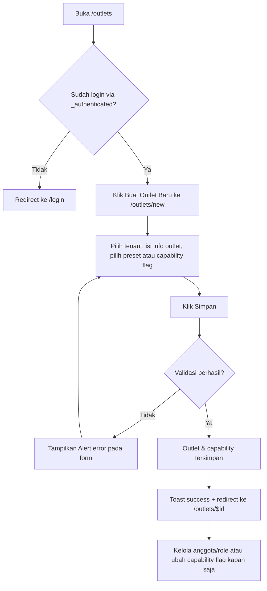
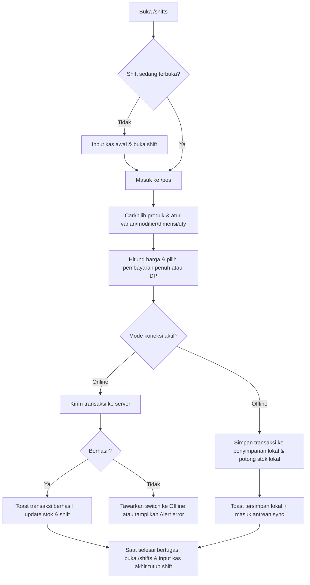
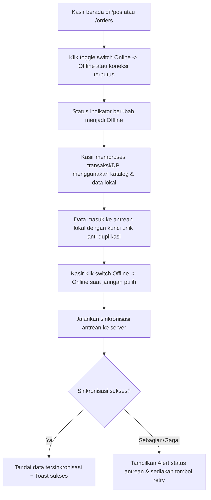
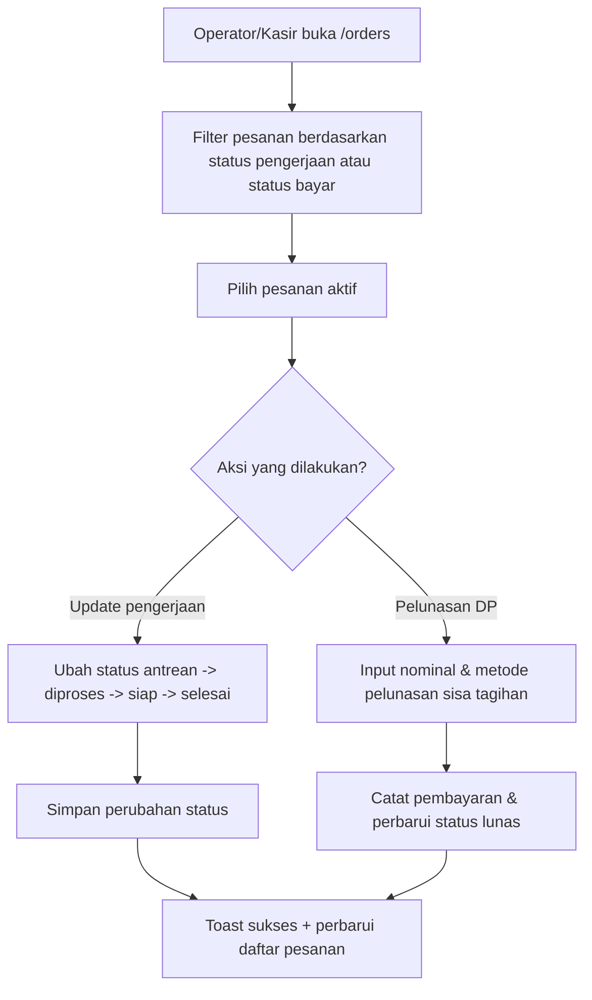
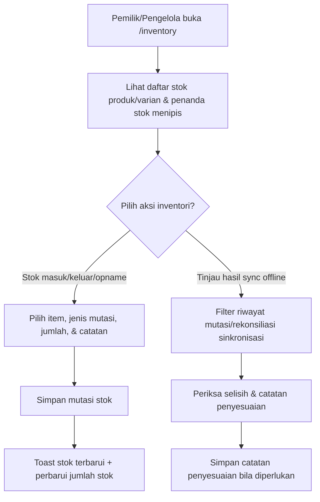

# UX Flow: Universal Multi-Capability POS Template

> Berdasarkan: PRD Universal Multi-Capability POS Template
> 
> 

---

## Sitemap

```text
/                                       → Landing / redirect ke /pos atau /login
├── /login                              → Halaman login pengguna[cite: 1]
├── /register                           → Halaman registrasi pengguna[cite: 1]
└── /_authenticated/                    → Layout route (auth guard & outlet context)[cite: 1]
    ├── /                               → Dashboard utama (ringkasan outlet, shift, status sync)[cite: 1]
    ├── /pos                            → Kasir & keranjang transaksi (online/offline switch, varian, modifier, dimensi/tiered, DP)
    ├── /orders                         → Daftar & alur pengerjaan pesanan (workflow status, pelunasan DP)
    ├── /shifts                         → Buka/tutup shift kasir & rekap sesi
    ├── /inventory                      → Manajemen stok masuk/keluar, stok menipis, & rekonsiliasi offline
    ├── /products                       → Katalog produk, varian, modifier, & aturan harga
    ├── /outlets                        → Daftar tenant & outlet
    │   ├── /new                        → Buat outlet baru & pilih preset/capability
    │   └── /$id                        → Detail outlet, pengaturan capability flag, & anggota/role
    └── /settings                       → Pengaturan akun & preferensi koneksi bawaan[cite: 1]

```

---

## Navigation Pattern

* **Layout utama**: Sidebar navigasi di desktop dan bottom navigation di mobile, dibungkus layout route `_authenticated.tsx`.


* **Konteks aktif**: Pemilih *outlet* aktif di header/sidebar beserta indikator status mode koneksi (*Online* / *Offline*) dan jumlah antrean sinkronisasi yang belum terkirim.
* **Navigasi sekunder**: Breadcrumb pada halaman detail outlet (`/$id`) serta tab/filter status pada daftar pesanan dan inventori.


* **Auth guard**: `_authenticated.tsx` memeriksa sesi JWT; jika belum login atau tidak berhak mengakses rute/capability tertentu, pengguna diarahkan ke `/login` atau ditolak dengan notifikasi.


* **Toast / Alert**: Menggunakan komponen `Alert` atom untuk pesan status/error inline dan `Toast` molecule untuk umpan balik aksi singkat.


---

## User Flows

### Flow 1: Setup Tenant, Outlet & Capability Flags



### Flow 2: Buka Shift, Transaksi Kasir (Varian, Modifier, Dimensi/Tiered, DP) & Tutup Shift



### Flow 3: Switch ke Mode Offline & Sinkronisasi Saat Kembali Online



### Flow 4: Alur Pengerjaan Pesanan & Pelunasan DP



### Flow 5: Manajemen Stok & Rekonsiliasi Hasil Sinkronisasi



---

## State per Halaman

### `/` (Dashboard Utama)

| State | Tampilan |
| --- | --- |
| Loading | Skeleton kartu ringkasan dan status shift/koneksi

 |
| Empty | Ringkasan awal tanpa transaksi + tautan cepat ke `/outlets/new` atau `/pos`

 |
| Error | `Alert` error + tombol coba lagi

 |
| Success | Ringkasan outlet aktif, status shift, status mode online/offline, antrean sync, & pintasan modul

 |

### `/pos` (Kasir & Keranjang Transaksi)

| State | Tampilan |
| --- | --- |
| Loading | Skeleton daftar katalog dan panel keranjang

 |
| Empty | Pesan katalog kosong atau keranjang masih kosong dengan panduan pilih item

 |
| Error | `Alert` kegagalan input/pengiriman transaksi + opsi simpan offline / retry

 |
| Success | Katalog sesuai capability aktif, konfigurasi item dinamis, keranjang, ringkasan bayar/DP, & `Toast` transaksi tersimpan

 |

### `/orders` (Daftar & Alur Pengerjaan Pesanan)

| State | Tampilan |
| --- | --- |
| Loading | Skeleton daftar/tabel pesanan

 |
| Empty | Tampilan kosong "Belum ada pesanan" dengan filter status aktif

 |
| Error | `Alert` error saat memuat atau memperbarui status/pelunasan + tombol retry

 |
| Success | Daftar pesanan beserta status pengerjaan, status pembayaran (Lunas/DP/Belum Lunas), aksi ubah status, & pelunasan

 |

### `/shifts` (Manajemen Shift Kasir)

| State | Tampilan |
| --- | --- |
| Loading | Skeleton informasi shift aktif dan riwayat shift

 |
| Empty | Form buka shift kasir (input kas awal) dan daftar riwayat kosong

 |
| Error | `Alert` validasi atau kegagalan buka/tutup shift

 |
| Success | Detail shift aktif, form tutup shift dengan rekap kas, histori shift, & `Toast` konfirmasi

 |

### `/inventory` (Manajemen Stok & Rekonsiliasi)

| State | Tampilan |
| --- | --- |
| Loading | Skeleton tabel stok dan riwayat mutasi

 |
| Empty | Tampilan kosong "Belum ada data stok" + tombol tambah produk atau catat mutasi

 |
| Error | `Alert` error saat memuat atau mencatat mutasi stok

 |
| Success | Daftar stok (dengan penanda stok menipis), form mutasi stok, riwayat mutasi/rekonsiliasi offline, & `Toast` sukses

 |

### `/products` (Katalog Produk & Aturan Capability)

| State | Tampilan |
| --- | --- |
| Loading | Skeleton daftar produk dan form katalog

 |
| Empty | Ilustrasi/teks "Belum ada produk" + tombol tambah produk

 |
| Error | `Alert` error validasi atau gagal simpan produk/varian

 |
| Success | Daftar produk, pengaturan harga (tetap/dimensi/tiered), varian, modifier, & `Toast` konfirmasi

 |

### `/outlets`, `/outlets/new`, `/outlets/$id` (Tenant, Outlet & Capability)

| State | Tampilan |
| --- | --- |
| Loading | Skeleton daftar outlet, form outlet baru, atau detail outlet

 |
| Empty | Tampilan "Belum ada outlet" + tombol CTA buat outlet baru

 |
| Error | `Alert` error saat memuat atau menyimpan pengaturan outlet/capability/member

 |
| Success | Daftar outlet, form pembuatan dengan preset/capability, toggle capability & manajemen anggota/role di detail outlet, & `Toast` sukses

 |

### `/settings` (Pengaturan Akun & Preferensi Koneksi)

| State | Tampilan |
| --- | --- |
| Loading | Skeleton form pengaturan

 |
| Empty | Nilai default pengaturan akun dan mode koneksi awal (`online`)

 |
| Error | `Alert` error saat menyimpan perubahan pengaturan

 |
| Success | Form tersimpan dengan `Toast` konfirmasi dan pembaruan preferensi aktif

 |

---

## Langkah Selanjutnya

Dokumen UX Flow (`ux-flow.md`) sudah selaras dengan PRD (`prd.md`), ERD (`erd.md`), dan API Contract (`api-contract.md`). Tahap berikutnya pada jalur frontend adalah menyusun **UI Spec (`ui-spec.md`)** berdasarkan dokumen ini. Apakah Anda ingin langsung melanjutkan ke **UI Spec**?
